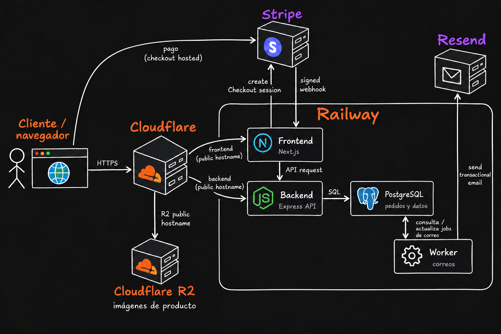
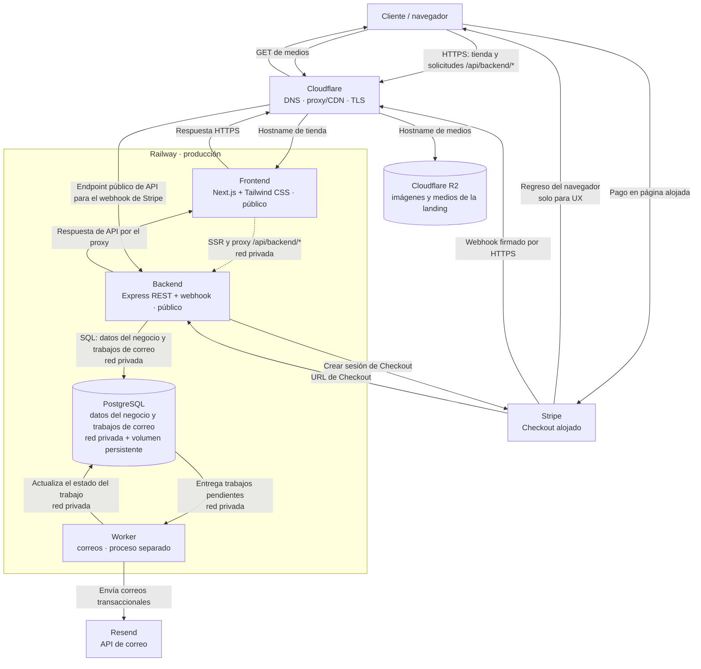
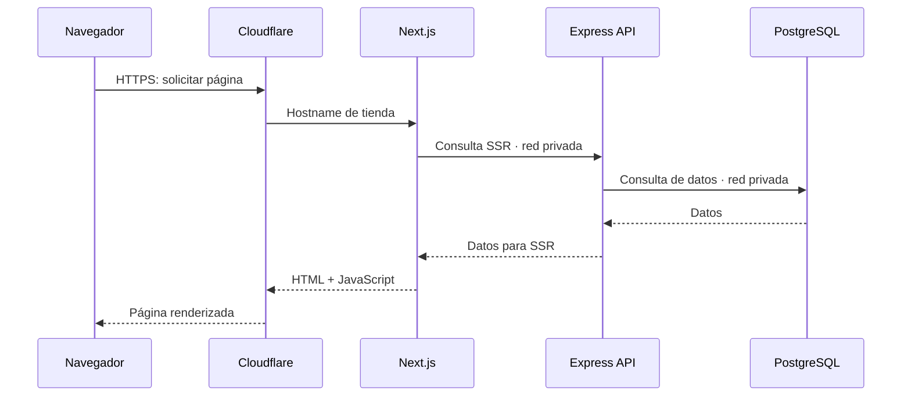
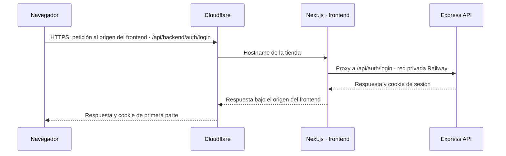

# Señor del Mictlán



Señor del Mictlán reúne mezcales de agave Cupreata silvestre y destilados procedentes de Etúcuaro, Michoacán. Este repositorio contiene el desarrollo de su tienda en línea, landing y catálogo digital.

El [roadmap](docs/ROADMAP.md) registra el estado de implementación y validación.

## Stack

| Área | Tecnología | Responsabilidad |
|---|---|---|
| Frontend | Next.js, React y Tailwind CSS 4 | Interfaz de la tienda, landing y catálogo público |
| Backend | Node.js y Express | API REST, autenticación, reglas de negocio y webhooks de Stripe |
| Base de datos | PostgreSQL en Railway | Usuarios, productos, carritos, pedidos y trabajos de correo |
| ORM y migraciones | Prisma ORM y Prisma Migrate | Acceso a PostgreSQL y migraciones versionadas del esquema |
| Tareas asíncronas | PostgreSQL | Guardar los trabajos de correo pendientes para que el worker los procese |
| Worker | Node.js en Railway | Leer y actualizar los trabajos en PostgreSQL y solicitar el envío a Resend |
| Pagos | Stripe Checkout | Checkout alojado y notificaciones firmadas de pago |
| Correo | Resend | Correos transaccionales, como recuperación de contraseña y confirmación de pedidos |
| Medios | Cloudflare R2 | Almacenar y entregar imágenes de producto y medios de la landing |
| Capa pública | Cloudflare Free | DNS autoritativo; proxy/CDN y TLS para los hostnames públicos; WAF, protección DDoS y Bot Fight Mode |
| Despliegue | Railway | Alojar frontend, backend, worker y PostgreSQL |

## Arquitectura

En producción, Cloudflare publica la tienda, el endpoint de la API para webhooks de Stripe y los medios. El navegador envía las solicitudes de la aplicación al mismo origen del frontend, bajo `/api/backend/*`; Next.js las reenvía a Express por la red privada de Railway. El renderizado del servidor también consulta Express por esa red. Stripe entrega sus webhooks al endpoint público de la API. El navegador carga las imágenes y los medios desde Cloudflare R2.

La estrategia prevista de renderizado y los criterios SEO están en [Renderizado y SEO](docs/architecture/RENDERING-AND-SEO.md).

El diagrama muestra las conexiones entre el navegador, Cloudflare, Railway y los servicios externos.

Para consultar las rutas públicas y privadas, revisa [Rutas y acceso](docs/architecture/ROUTES-AND-ACCESS.md). El [alcance del MVP](docs/MVP_SCOPE.md) reúne sus límites.



### Flujos principales

Los recorridos distinguen la carga SSR, las solicitudes del navegador que pasan por el proxy del frontend y el webhook público de Stripe.

#### Carga de una página renderizada por servidor



#### Interacción que requiere la API



- Express comprueba que los productos sigan activos y usa sus precios vigentes; PostgreSQL conserva el pedido y sus datos históricos. El MVP no comprueba existencias.
- Express crea la sesión de Stripe y devuelve al navegador la URL para abrir el Checkout alojado.
- El backend verifica la firma del webhook de Stripe. Cuando confirma un pago, valida la sesión, el importe y la moneda antes de marcar el pedido como pagado; en la misma transacción registra en PostgreSQL el trabajo de confirmación. El worker procesa ese trabajo y envía el correo mediante Resend. Los eventos de pago fallido o Checkout expirado cierran el pedido pendiente sin generar ese correo. Al volver de Checkout, la página consulta al backend el estado del pedido; sólo el webhook firmado puede confirmarlo como pagado.
- El navegador obtiene las imágenes de producto y los medios de la landing mediante Cloudflare R2. PostgreSQL conserva referencias y metadatos, no los archivos.

## Ramas y despliegues

La política del repositorio fija visibilidad pública y usa `develop` como rama predeterminada para Staging; `main` corresponde a Producción. Los cambios de ambas ramas se integran mediante pull request.

Las ramas `develop` y `main` reciben cambios mediante pull request. Sus reglas se aplican también a administradores y bloquean force-push y eliminación de ramas. No requieren aprobación de otro colaborador. GitHub Actions ejecuta las comprobaciones de calidad; los checks verificados se configuran como obligatorios para fusionar.

La política **Automatically delete head branches** elimina las ramas de origen al fusionar un pull request.

```text
feature/* ── pull request ──> develop ──> Railway Staging
                                  │
                           pull request
                                  ↓
                                main ──> Railway Producción
```

## Clonar y configurar el repositorio

Se requiere Git, Docker Engine y Docker Compose. Desde la carpeta donde guardarás el proyecto:

```bash
git clone https://github.com/sadamlg/sr_del_mictlan.git
cd sr_del_mictlan
cp .env.example .env
```

`.env.example` contiene valores de desarrollo locales. `.env` está excluido de Git; conserva allí sólo credenciales de desarrollo y nunca agregues secretos reales al repositorio.

La [guía de infraestructura Docker Compose](docs/architecture/docker/COMPOSE.md) explica el stack local, su comprobación, los servicios y el acceso LAN.

### Iniciar el entorno

Valida la configuración y construye e inicia los servicios en segundo plano:

```bash
docker compose config --quiet
docker compose up --build --detach --wait --wait-timeout 180
docker compose ps
```

La opción `--build` reconstruye las imágenes antes de iniciar los contenedores.

Docker Compose construye las imágenes del frontend y backend, y levanta frontend, API, PostgreSQL, worker y Mailpit. `--wait` espera los health checks. El frontend ejecuta `npm run dev`; el backend genera Prisma Client, aplica las migraciones y ejecuta Express; el worker registra un latido en PostgreSQL. `docker compose exec worker npm run worker:mail-smoke` comprueba la entrega SMTP a Mailpit. No hace falta instalar Node.js en el anfitrión.

| Servicio o endpoint | Dirección local |
|---|---|
| Frontend Next.js | [http://localhost:3000](http://localhost:3000) |
| API; comprobar salud | [http://localhost:4000/health](http://localhost:4000/health) |
| API; prueba de comunicación | [http://localhost:4000/api/hello](http://localhost:4000/api/hello) |
| Mailpit; bandeja de correo de desarrollo | [http://localhost:8025](http://localhost:8025) |
| Worker | Sin puerto publicado; escribe su latido en PostgreSQL dentro de Compose |
| PostgreSQL | `localhost:5432` |

#### Acceso desde la LAN

Con `.env` creado, publica temporalmente frontend, API y la bandeja web de Mailpit en la red local. Sustituye `192.168.100.2` por la IPv4 actual de este equipo si cambia:

```bash
scripts/dev-lan.sh up 192.168.100.2
```

Desde otro dispositivo de la misma red abre `http://192.168.100.2:3000` (frontend), `http://192.168.100.2:4000/health` (API) o `http://192.168.100.2:8025` (Mailpit). Para volver al acceso local:

```bash
scripts/dev-lan.sh off
```

PostgreSQL permanece enlazado a localhost y el SMTP de Mailpit no se publica fuera de Compose. El script restaura los enlaces originales al desactivar LAN.

### Reiniciar, recrear o reconstruir frontend y API

Usa el comando según el tipo de cambio:

```bash
# Reinicia los procesos dentro de los contenedores existentes.
docker compose restart frontend backend

# Recrea ambos contenedores para aplicar cambios de .env o compose.yaml.
docker compose up --detach --force-recreate frontend backend

# Reconstruye sus imágenes y recrea los contenedores tras cambiar Dockerfiles,
# dependencias o configuración de Next.js que se copia a la imagen.
docker compose up --build --detach --force-recreate frontend backend
```

Usa `restart` si el proceso del frontend o de la API se detuvo o quedó bloqueado. Los cambios normales de código se aplican automáticamente durante el desarrollo.

Para consultar la salida de los servicios, ejecuta `docker compose logs --follow`; Ctrl+C deja los contenedores en ejecución. Para detenerlos:

```bash
docker compose down
```

Este comando conserva los volúmenes locales de PostgreSQL. `docker compose down -v` también los elimina y borra los datos locales.
