# Roadmap

Este documento resume el resultado principal y la aceptación de cada fase, junto con decisiones y riesgos que afectan el lanzamiento. No es una bitácora de herramientas, cambios ni implementaciones. Los procedimientos reproducibles viven en las guías enlazadas; aquí conservamos sólo evidencia de alto impacto que explica una decisión o bloquea la aceptación.

El alcance aprobado está en [MVP_SCOPE.md](MVP_SCOPE.md), las decisiones transversales en [AGENTS.md](../AGENTS.md) y el comportamiento de cada módulo en sus contratos de `docs/contracts/`.

| Fase | Resultado | Estado |
|---|---|---|
| 00 · Repositorio | GitHub y base documental | Completada |
| 01 · Entorno local y Docker | Stack local reproducible y CI básico | Completada |
| 02 · Alcance y arquitectura | Alcance MVP y contratos transversales | Completada |
| 03 · Landing, catálogo y medios | Tienda pública y entrega de imágenes | Completada |
| 04 · Cuentas y perfil | Registro, sesión y administración de cuenta | Completada |
| 05 · Carritos | Carrito de invitado y cuenta | Completada |
| 06 · Checkout y pedidos | Pagos Stripe y órdenes confirmadas por webhook | Completada |
| 07 · Correo y PDF | Worker y mensajes transaccionales | Implementación local completada; integración externa validada en fase 08 |
| 08 · Staging | Despliegue e integración de proveedores | Completada; Railway Staging activo |
| 09 · Validación previa a Producción | Validación técnica de Staging | Completada con excepción de LCP |
| 10 · Producción | Preparación operativa y salida autorizada | Planeada |

## Secuencia

```mermaid
flowchart LR
    p00["00 Repositorio"] --> p01["01 Docker y CI"] --> p02["02 Alcance y arquitectura"] --> p03["03 Tienda y medios"] --> p04["04 Cuentas"] --> p05["05 Carritos"] --> p06["06 Checkout y pedidos"] --> p07["07 Correo y PDF"] --> p08["08 Staging"] --> p09["09 Validación"] --> p10["10 Producción"]
```

## Hitos y alcance por fase

### 00. Repositorio — completada

- Repositorio público `sadamlg/sr_del_mictlan` con ramas `develop` y `main` y documentación base del proyecto.

### 01. Entorno local y Docker — completada

- Compose levanta Next.js, API Express, PostgreSQL, Prisma, Worker y Mailpit; CI cubre pruebas, ESLint, build y validaciones de Prisma.

### 02. Alcance y arquitectura — completada

- `docs/MVP_SCOPE.md` define el MVP y el repositorio establece sus decisiones transversales. Cada módulo concreta su contrato en la fase correspondiente.
- El navegador usa el proxy del Frontend hacia la API privada en entornos remotos; Stripe entrega webhooks al Backend por HTTPS.

### 03. Landing, catálogo y medios — completada

- La tienda contiene landing, tres fichas de catálogo, aviso de edad y contador de visitas. R2 aloja los medios públicos; la aplicación no necesita credenciales de escritura.
- La carga de medios es manual; Staging y Production mantienen buckets separados y Production usa un hostname propio.

### 04. Cuentas y perfil — completada

- Registro con validación de edad, confirmación por correo, inicio y restauración de sesión, recuperación de contraseña, perfil y Mis pedidos. La API valida Turnstile; la clave secreta permanece en Backend.
- El proxy del Frontend conserva la sesión y las cuentas se activan al confirmar el correo.

### 05. Carritos — completada

- Hay carritos de invitado y de cuenta. La transferencia es idempotente, el backend aplica precios actuales y no se reservan existencias.
- El webhook de pago elimina sólo las líneas compradas y conserva los cambios concurrentes del carrito.

### 06. Stripe Checkout y pedidos — completada

- La API crea sesiones alojadas de Checkout y confirma pedidos sólo mediante webhooks firmados. El procesamiento es idempotente y no almacena el número completo ni el CVC.
- La compra local usa el sandbox de Stripe. El backend confirma pedidos sólo mediante webhooks firmados e idempotentes; la aplicación no almacena datos completos de tarjeta.

### 07. Correo transaccional y PDF — implementación local completada

- PostgreSQL mantiene la cola transaccional; el Worker procesa confirmaciones de cuenta, recuperación y compras con PDF.
- Compose usa Mailpit de forma predeterminada; Resend local es opcional y Staging confirma la entrega externa. La [guía de Resend](architecture/services/RESEND.md) explica los perfiles y la separación de credenciales.

### 08. Staging — completada

- Railway integra PostgreSQL, Backend, Worker y Frontend con los proveedores externos. En Staging aceptamos registro, correo, Turnstile, sesión, recuperación de contraseña y compra de prueba con Stripe; no se procesan pagos reales. La [guía de Railway](architecture/services/RAILWAY.md) contiene el procedimiento de despliegue.
- `srmictlan.com` conecta el dominio al Frontend de Staging y no representa Production. Antes de validar, confirmamos que el dominio y el despliegue pertenecen al entorno elegido.

### 09. Validación previa a Producción — completada con excepción de LCP

**Resultado de fase:** El candidato de Frontend desplegado en Staging pasa CI; los cuatro servicios están en línea. `/health`, la no indexación, los encabezados y CSP se verificaron. Playwright/axe pasó con escrituras de prueba bloqueadas; en Chrome se comprobaron Turnstile real, registro, activación, recuperación, inicio de sesión y una compra de prueba con su recibo y PDF. La salida a Production sigue condicionada a los controles operativos y manuales indicados en la fase 10.

- Staging mantiene pagos en modo de prueba y `noindex`. CI ejecuta auditoría de dependencias, pruebas, lint, build, Playwright/axe, integración PostgreSQL y una restauración cifrada sintética. El límite por correo usa HMAC, por lo que rotar cookies no permite evadir la cuota; Cloudflare agrega el límite breve por IP a las rutas de cuenta. Backend tiene una réplica; al escalar, el contador en memoria requerirá almacenamiento compartido.
- La consulta de sesión empieza antes de hidratar, reutiliza una sola petición y respeta la URL de API configurada. Las fotos secundarias del catálogo conservan carga diferida y se revelan con transición de opacidad, eliminando el desfase del primer hover observado.
- ZAP revisó pasivamente 117 URL y no confirmó hallazgos críticos o altos. La revisión señaló cabeceras de aislamiento entre orígenes ausentes y CSP en respuestas 404 malformadas; la política efectiva de la landing y los recorridos pasan. Esta revisión pasiva no equivale a una prueba de penetración completa.
- El WebP móvil de 27,656 bytes conserva el encuadre del escaparate; el dominio propio de R2 entrega las imágenes actuales de Staging con caché y sin indexación. Cinco mediciones móviles comparables de Lighthouse dan medianas de 96/100 y LCP de 2.68 s. El responsable acepta expresamente la desviación de 0.18 s respecto al objetivo de 2.5 s para cerrar esta validación; el seguimiento queda en Production. Las imágenes siguen visibles y las variantes que deterioraban su presentación no se conservan.
- El respaldo `pg_dump` cifra, transfiere, valida y restaura datos sintéticos en CI. Axe y la revisión manual de teclado en pedidos no encontraron bloqueo de foco. La revisión con lector de pantalla y zoom al 200% queda a cargo del responsable antes de la salida a Production.

### 10. Producción — planeada

Preparar Production con recursos, base, credenciales y medios independientes. Configurar y probar el respaldo diario `pg_dump` cifrado en bucket privado de R2, retención, alertas y restauración aislada; medir RTO y ensayar rollback sin tocar Staging compartido. Completar la revisión manual de accesibilidad y repetir Lighthouse en el dominio final, dando seguimiento al LCP de 2.68 s aceptado como excepción en Staging. Seguir el [runbook maestro de Producción](operations/PRODUCTION-RUNBOOK.md). Habilitar indexación y pagos reales sólo después de las puertas de salida y la autorización correspondiente.
