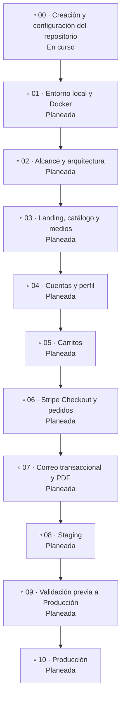

# Roadmap

Este roadmap fija la secuencia, dependencias, resultados y comprobaciones de cada fase. El alcance maestro del MVP se revisará y aprobará en la fase 02 (`docs/MVP_SCOPE.md`). Las guías operativas de arquitectura y proveedores se preparan en las fases que las necesitan; su presencia futura no acredita que un servicio esté configurado.

Las reglas duraderas del repositorio están en [AGENTS.md](../AGENTS.md). El alcance maestro (`docs/MVP_SCOPE.md`) y las decisiones transversales se preparan en la fase 02; cada contrato de módulo se revisa al iniciar su fase funcional. El CI mínimo se prepara en la fase 01 y la guía de validación integral (`docs/quality/QUALITY-AND-RELEASE.md`) en la fase 09. Este documento organiza ese trabajo por fase.

| Fase | Resultado | Estado |
|---|---|---|
| 00 · Creación y configuración del repositorio | Repositorio GitHub, ramas y documentación inicial | En curso |
| 01 · Entorno local y Docker | Stack reproducible en Compose, con acceso local y opción LAN | Planeada |
| 02 · Alcance y arquitectura | Alcance maestro y arquitectura transversal; los contratos de módulo se detallan en sus fases | Planeada |
| 03 · Landing, catálogo y medios | Catálogo, presentación, medios y carga pública | Planeada |
| 04 · Cuentas y perfil | Registro, confirmación, sesión, recuperación y perfil | Planeada |
| 05 · Carritos | Carrito de invitado, cuenta y transferencia | Planeada |
| 06 · Stripe Checkout y pedidos | Compra, webhook firmado, pedidos e idempotencia | Planeada |
| 07 · Correo transaccional y PDF | Resend, mensajes de compra y detalle de pedido | Planeada |
| 08 · Staging | Railway, integraciones aisladas y aceptación de recorridos | Planeada |
| 09 · Validación previa a Producción | CI, recorridos de navegador, accesibilidad, rendimiento, seguridad y operación | Planeada |
| 10 · Producción | Dominio público, medios, costos, operación y salida autorizada | Planeada |

## Secuencia

## Plan por fases

### 00. Creación y configuración del repositorio — en curso

- **Objetivo:** crear `sadamlg/sr_del_mictlan` en GitHub y su copia local, con documentación y configuración inicial del proyecto.
- **Dependencias:** acceso autorizado a la cuenta `sadamlg`; comprobar que el nombre esté disponible y revisar los ajustes actuales antes de reproducirlos. La visibilidad, permisos y opciones deben comprobarse en GitHub, no suponerse.
- **Resultado:** repositorio GitHub público, ramas `develop` y `main`, `develop` como predeterminada, eliminación automática de ramas fusionadas y documentación inicial aprobada. El `.gitignore` excluye secretos, datos personales y artefactos.
- **Medios y licencias:** `docs/architecture/ARCHITECTURE.png` es el diagrama de arquitectura incluido (PNG, 1536 × 1024; SHA-256 `88f174853e52fcebbd0c39c971480632fb20b3f5fecab0ab0e2f8867cfd24520`). No se incluyen fuentes ni código de aplicación. No se agregó archivo de licencia ni se eligió una licencia.
- **Comprobaciones:** confirmar propietario, nombre, visibilidad, acceso, ramas, rama predeterminada, eliminación automática y reglas de protección. Ambas ramas requieren pull request; las reglas aplican a administradores y prohíben force-push y eliminación. Registrar aquí la configuración observada y las limitaciones. El CI mínimo se implementa y verifica en la fase 01, cuando existan frontend, backend y sus lockfiles.
- **Estado de CI y checks:** el baseline local no contiene un workflow de GitHub Actions y no hay checks obligatorios configurados. El destino remoto aún no existe. Registrar los nombres de los checks que se creen y cuáles se marquen obligatorios después de verificar el workflow.
- **Estado y evidencia:** en curso. El 12 de noviembre de 2026, la copia local tiene un único commit raíz compartido por `main` y `develop`; no se hizo push ni se abrió un pull request. El formulario de GitHub muestra disponible el nombre `sadamlg/sr_del_mictlan`; el repositorio no se ha creado. Visibilidad, rama predeterminada, eliminación automática y protecciones quedan pendientes de creación y verificación. Registrar el hash de la copia local junto con la configuración comprobada al publicar el baseline.

### Cuándo se definen los contratos

La fase 02 aprueba el alcance maestro del MVP, la arquitectura transversal, las interfaces compartidas y la secuencia de dependencias. **No cierra por adelantado el comportamiento detallado de cada módulo.** Al iniciar cada fase funcional, se revisa y ajusta su contrato antes de implementar; el contrato guía su alcance y comprobaciones. Los documentos en <code>docs/contracts</code> describen el comportamiento previsto, no acreditan que ya esté implementado o validado. Las fases 03–07 enlazan el contrato correspondiente. Las fases de infraestructura, como Staging y Producción, actualizan las guías de proveedor que les corresponden.

### 01. Entorno local y Docker — planeada

- **Objetivo:** permitir que una copia limpia del repositorio levante el stack de desarrollo y sus dependencias sin instalar Node.js en el equipo anfitrión.
- **Dependencias:** fase 00 completada.
- **Resultado:** frontend Next.js, API Express, PostgreSQL, Prisma, worker y Mailpit en Docker Compose. El modo local estándar enlaza servicios al loopback; el modo LAN es opcional y reversible y cambia la publicación de puertos y las direcciones usadas por el navegador. Los medios pueden servirse localmente o desde R2 sin cambiar los puertos de Compose.
- **CI del proyecto:** crear y verificar un workflow mínimo con lint de frontend y backend. Tras un run satisfactorio, comprobar los nombres reales de los checks y configurarlos expresamente como obligatorios en las reglas de `develop` y `main`. Añadir pruebas y build conforme se implementen módulos. La fase 09 añade la validación integral en Staging y prepara `docs/quality/QUALITY-AND-RELEASE.md`.
- **Comprobaciones:** reconstruir y levantar Compose desde la guía; comprobar frontend, API, base de datos, worker y recepción de correo en Mailpit. Si se usa LAN, confirmar acceso desde otro dispositivo y poder volver al modo local. La guía distingue estos modos de los Dockerfiles de producción que se preparan en la fase 08.
- **Estado y evidencia:** planeada; registrar pruebas, entorno, fecha y commit al completar la fase.

### 02. Alcance y arquitectura — planeada

- **Objetivo:** validar el alcance maestro del MVP y definir la arquitectura transversal: cómo se comunican navegador, frontend, API y servicios externos antes de construir los módulos.
- **Dependencias:** fase 01.
- **Resultado:** alcance maestro en `docs/MVP_SCOPE.md`, reglas duraderas en [AGENTS.md](../AGENTS.md), decisiones transversales de arquitectura y secuencia de dependencias. La arquitectura aprobada definirá cómo se comunican navegador, frontend, API y servicios externos en cada entorno. El comportamiento detallado de cada módulo se define o ajusta en su fase, antes de implementar ese módulo.
- **Motivo y momento de validación:** definir y comprobar las rutas públicas, el proxy del frontend y la sesión antes de implementar cuentas; validar la integración desplegada en la fase 08.
- **Comprobaciones:** `docs/MVP_SCOPE.md`, los diagramas y el README describen la arquitectura aprobada; las guías separan las rutas locales y de producción; la API privada del navegador no se presenta como pública; cada fase funcional revisa su contrato antes de implementar.
- **Estado y evidencia:** planeada; registrar pruebas, entorno, fecha y commit al completar la fase.

### 03. Landing, catálogo y medios — planeada

- **Objetivo:** implementar la landing, el catálogo y los medios dentro del alcance aprobado.
- **Dependencias:** fases 01 y 02. Antes de cargar medios reales, el responsable del proyecto prepara la cuenta y el bucket no productivo de Cloudflare R2.
- **Contrato del módulo:** revisar y cerrar `docs/contracts/03-LANDING.md`, que reúne catálogo y contador de visitas, antes de implementar esas capacidades.
- **Resultado:** landing, tres fichas locales de catálogo, contador de visitas, aviso de edad e imágenes con claves estables. Desarrollo puede servir los archivos localmente o desde R2; staging usa medios no productivos; producción tendrá bucket y hostname propios. `r2.dev` se reserva para desarrollo/staging y no requiere cambiar DNS. La carga del MVP es manual; la aplicación no recibe credenciales de escritura. Cada entorno necesita sus migraciones; el catálogo de demostración se carga manualmente con `backend/prisma/dev-showcase.sql`.
- **Entrega y optimización de imágenes:** definir y comprobar qué superficies usarán el optimizador de Next.js y cuáles entregarán los originales. R2 no se considera un servicio de conversión de imágenes. Evaluar formatos, tamaños y transformaciones según el comportamiento que se implemente.
- **Precios del catálogo:** usar datos de prueba claramente separados de los precios comerciales. El responsable debe aprobar los precios finales antes de habilitar ventas reales.
- **R2 y entrega pública:** decidir el origen de medios de cada entorno y revisar cuotas antes de cargar archivos. La entrega pública, el dominio personalizado y cualquier servicio de optimización se comprueban por separado.

- **Presentación y entrega:** las animaciones de interfaz se resuelven con CSS donde corresponde y respetan `prefers-reduced-motion`; no se depende de archivos animados pesados si una animación CSS cubre el caso. El catálogo público tendrá una estrategia de renderizado, caché y metadatos; las rutas privadas no deben servirse desde caché pública. Stripe necesita imágenes públicas HTTPS al crear Checkout, mediante `STRIPE_MEDIA_BASE_URL` del entorno.
- **Comprobaciones:** la landing y los productos activos se muestran; las claves y metadatos resuelven el medio correcto en cada entorno; se comprueba el tratamiento de imágenes de cada superficie; el aviso de edad funciona; la interfaz respeta movimiento reducido; se comprueba que el proveedor de pago pueda obtener las imágenes cuando se usa Checkout remoto.
- **Estado y evidencia:** planeada; registrar pruebas, entorno, fecha y commit al completar la fase.

### 04. Cuentas y perfil — planeada

- **Objetivo:** ofrecer registro, autenticación, recuperación y administración del perfil.
- **Dependencias:** fases 01 y 02; las pantallas se integran con las superficies definidas en fase 03.
- **Contrato del módulo:** revisar y cerrar `docs/contracts/04-ACCOUNTS-PROFILE.md` antes de implementar registro, sesión y perfil.
- **Resultado:** registro con validación de mayoría de edad y dirección; confirmación de correo; inicio, cierre y restauración de sesión; recuperación de contraseña; edición de nombre(s), apellidos, correo, fecha de nacimiento y dirección; perfil y Mis pedidos, conectado a órdenes reales en la fase 06. Los datos de cuenta se guardan en PostgreSQL. Las cuentas nuevas permanecen pendientes hasta consumir el enlace; un cambio de correo sólo se aplica tras confirmar el nuevo destino. Confirmar puede iniciar sesión y, si la persona venía de comprar, retomar el carrito y el resumen de compra.
- **Correo local:** probar mensajes de cuenta con el worker y Mailpit en Compose. El envío desde un dominio real se prepara en la fase 07; no se requiere Resend para desarrollar las cuentas localmente.
- **Sesión y estados de interfaz:** producción usa el proxy del frontend definido en fase 02 para conservar la cookie bajo el origen de la tienda. Comprobar confirmación e inicio desde otro dispositivo; no asumir que confirmar correo en un dispositivo inicia sesión en otro. Si se abandona la vista de revisión de correo y se vuelve al login, la interfaz debe reflejar el estado real de la cuenta y permitir iniciar sesión después de confirmarla, sin conservar un mensaje de registro obsoleto.
- **Comprobaciones:** registro pendiente y confirmado, login, restauración, recuperación, cambio de correo confirmado, validaciones del backend, estados de carga/error/sesión vencida y privacidad de contraseñas y tokens. En Compose verificar los mensajes en Mailpit.
- **Estado y evidencia:** planeada; registrar pruebas, entorno, fecha y commit al completar la fase.

### 05. Carritos — planeada

- **Objetivo:** permitir preparar una compra como invitado o con cuenta y fusionar ambos carritos al iniciar sesión.
- **Dependencias:** fases 03 y 04.
- **Contrato del módulo:** revisar y cerrar `docs/contracts/05-CARTS.md` antes de implementar el carrito persistente y la fusión de carritos. La integración del pago con Stripe se especifica en el contrato de la fase 06.
- **Resultado:** carrito de invitado persistido en el navegador por 30 días y carrito de cuenta en PostgreSQL. La transferencia suma cantidades de forma idempotente; el backend calcula precios actuales. Los productos inactivos se pueden quitar, pero no comprar. No se reservan ni verifican existencias.
- **Sincronización con Checkout:** al confirmar un pago, el webhook elimina sólo las líneas que coinciden con la instantánea comprada. Si la persona cambia el carrito mientras Stripe Checkout está abierto, esos cambios se conservan. Esta dependencia se implementa y valida junto al flujo de pago de la fase 06.
- **Comprobaciones:** reintentar la fusión no duplica cantidades, un error conserva el carrito local, se muestra un único carrito y Checkout rechaza productos inactivos o precios inválidos.
- **Estado y evidencia:** planeada; registrar pruebas, entorno, fecha y commit al completar la fase.

### 06. Stripe Checkout y pedidos — planeada

- **Objetivo:** aceptar pagos alojados por Stripe y confirmar las compras sólo mediante webhooks firmados.
- **Dependencias:** fases 03, 04 y 05.
- **Contrato del módulo:** revisar y cerrar `docs/contracts/06-CHECKOUT-ORDERS.md` antes de implementar pagos, webhooks y órdenes.
- **Stripe local:** primero probar en modo de prueba desde Compose con Stripe CLI y un túnel hacia el endpoint local. Reenviar sólo los eventos que procesa la aplicación y usar el `whsec_…` entregado por esa sesión local. La guía de Stripe se preparará en esta fase.
- **Resultado:** el servidor vuelve a validar disponibilidad y precios, crea una instantánea pendiente y abre Stripe Checkout. El webhook firmado confirma pagos, guarda la orden histórica y limpia las líneas compradas de forma idempotente. Sólo se muestran pedidos pagados a su titular. El resumen permite cambiar el destinatario sin alterar el perfil, consultar datos seguros de tarjetas guardadas y volver a pedir. No se almacena el número completo ni el CVC de la tarjeta.
- **Stripe en staging:** al desplegar en la fase 08, crear en el dashboard de Stripe un webhook HTTPS dirigido al dominio público de la API y `/api/webhooks/stripe`. Configurar los eventos documentados y guardar su secreto `whsec_…` en el backend de staging. Las claves y secretos de staging no se comparten con el túnel ni con producción.
- **Comprobaciones:** precios y disponibilidad vigentes, firma válida e inválida, eventos repetidos, estado pagado determinado por webhook y no por el retorno del navegador, orden visible en Mis pedidos y limpieza del carrito sin perder ediciones realizadas durante Checkout.
- **Estado y evidencia:** planeada; registrar pruebas, entorno, fecha y commit al completar la fase.

### 07. Correo transaccional y PDF — planeada

- **Objetivo:** entregar mensajes de cuenta y una confirmación de compra con un único PDF de detalle del pedido.
- **Dependencias:** fase 04 para mensajes de cuenta y fase 06 para pedidos pagados. Antes de habilitar envíos desde un dominio propio, el responsable del proyecto crea la cuenta de Resend y prepara el dominio de envío en el DNS autoritativo elegido.
- **Contrato del módulo:** la fase 04 define el correo de cuenta en `docs/contracts/04-ACCOUNTS-PROFILE.md`; la fase 06 define el correo de compra/PDF en `docs/contracts/06-CHECKOUT-ORDERS.md`. Revisar esos criterios antes de implementar la entrega en esta fase. La integración y los límites del proveedor se documentan en una guía preparada en la fase 07.
- **07.1 · Verificar el flujo local:** probar registro, recuperación y compra desde Compose; Mailpit debe recibir tanto correo de cuenta como de compra y el correo de compra debe incluir el PDF. Confirmar reintentos, tratamiento de fallos e idempotencia sin depender de un proveedor remoto.
- **07.2 · Preparar dominio y remitentes:** añadir en el Zone Editor los registros exactos que muestre Resend para el dominio remitente elegido, comprobar la verificación y preservar los MX y registros de otros servicios. No usar la sección de child nameservers para crear TXT/CNAME/MX ni cambiar toda la delegación DNS para verificar un registro. La guía del proveedor se preparará en esta fase.
- **07.3 · Revisar capacidad de envío:** comprobar en la cuenta el plan, límites y precios vigentes antes de configurar envíos. Confirmación, recuperación y compras comparten esos límites. No habilitar sobreconsumos ni agregar un método de pago sin presupuesto aprobado. La guía de Resend se preparará en esta fase.

- **Resultado:** PostgreSQL persistirá un solo trabajo de confirmación por pedido pagado y el worker lo procesará. En Compose, el worker usará SMTP hacia Mailpit; en Railway, usará la API HTTPS de Resend. La clave pertenecerá al Worker y se separará por entorno. `MAIL_FROM` se usará para mensajes de cuenta y `RESEND_FROM` para compras. No se añadirá otro broker a la cola persistida. El worker registrará tipo de trabajo, intento y error sin volcar destinatarios, domicilios ni contenido del mensaje.
- **Comprobaciones:** dominio verificado, remitentes autorizados, enlaces con el origen del entorno correcto, mensaje visible en Resend y en la bandeja destino, PDF con el detalle correcto y trabajo recuperable ante fallos. No guardar claves en el repo ni configurarlas como `SMTP_PASSWORD`.
- **Estado y evidencia:** planeada; registrar pruebas, entorno, fecha y commit al completar la fase.

### 08. Staging — planeada

- **Objetivo:** desplegar y aceptar la aplicación en servicios no productivos que reproduzcan la arquitectura de producción.
- **Dependencias:** fases 01–07; cuenta Railway del responsable del proyecto, PostgreSQL de staging, Dockerfiles de producción, bucket de medios no productivo, claves de Stripe de prueba y configuración de Worker/Resend de staging. El responsable crea un widget Turnstile de staging y autoriza el hostname público del frontend antes de añadir sus claves a Railway; no requiere migrar DNS ni activar un proxy Cloudflare. Confirmar que los Dockerfiles estén versionados antes de crear los servicios.
- **08.1 · Crear servicios Railway:** configurar `postgres`, `api`, `worker` y `frontend` por separado. Usar `backend/Dockerfile.production` para API y Worker y `frontend/Dockerfile.production` para Next.js; ejecutar migraciones desde el servicio API. La guía indica raíz, comandos, health check, red privada y variables. `INTERNAL_API_URL` permite que Next.js use la URL privada de la API; su dominio público recibe el webhook. No desplegar Mailpit.
- **08.2 · Aislar proveedores y medios:** cada servicio conserva variables y secretos propios de staging. Usar webhook HTTPS de Stripe con su propio secreto, bucket/hostname no productivo y remitentes de Resend verificados. Los dominios públicos de Railway bastan para iniciar; Cloudflare DNS/TLS para un dominio de staging sólo se configura si ese dominio está disponible y se necesita.
- **08.3 · Revisar el consumo de Railway:** inspeccionar el control de uso a nivel del workspace y dejar documentado si existen alerta suave y límite duro. El umbral se decide según presupuesto aprobado; no asignarlo por intuición. Registrar el alcance y el comportamiento observado en la guía de Railway que se preparará en esta fase.
- **08.4 · Completar controles del MVP:** verificar Turnstile en registro e inicio de sesión, validación Siteverify de token, hostname y acción, y casos válidos e inválidos. Configurar claves y hostname propios con las guías de Cloudflare y Railway preparadas para esta fase.
- **Comprobaciones de recorrido completo:** desde móvil y escritorio, registrar, recibir y consumir confirmación, iniciar sesión, recuperar contraseña, consultar catálogo/imágenes, preparar carrito, pagar con Stripe de prueba, confirmar por webhook, comprobar que se limpia sólo lo comprado y recibir el correo con PDF. Revisar también errores de consola y solicitudes; una prueba de compra aislada no acredita todos estos recorridos.
- **Estado y evidencia:** planeada; registrar pruebas, entorno, fecha y commit al completar la fase.

### 09. Validación previa a Producción — planeada para el proyecto

- **Objetivo:** obtener evidencia reproducible de calidad funcional, accesibilidad, rendimiento, seguridad y recuperación del candidato antes de abrir Producción.
- **Dependencias:** reconstrucción verificada de las fases 01–08 en el proyecto; CI básico preparado desde el inicio; Staging desplegado con commit identificable y proveedores de prueba. El responsable prepara antes de las pruebas cuentas/bandejas de prueba, acceso administrativo a GitHub/Railway y recursos aislados de PostgreSQL, Stripe, Resend y Cloudflare. Revisar cuotas y presupuesto antes de activar servicios adicionales.
- **Resultado:** suites de Playwright y axe, informes Lighthouse y ZAP Baseline, revisión de seguridad, checks de GitHub Actions y evidencia de restauración/rollback. Las herramientas se ejecutan desde el equipo o runners temporales; Playwright no requiere un servicio permanente en Compose. La guía `docs/quality/QUALITY-AND-RELEASE.md`, que se preparará en esta fase, definirá el paquete obligatorio, complementos opcionales, orden y fuentes.
- **Comprobaciones:** lint, pruebas y build aprobados; recorridos críticos reales de Staging documentados; accesibilidad automática y manual revisada; mediciones de rendimiento y SEO guardadas con objetivos acordados; hallazgos altos/críticos confirmados resueltos; restauración, alertas y rollback comprobados. Asociar resultados al mismo candidato y distinguir simulaciones, omisiones y bloqueos. Registrar responsable y aceptación antes de avanzar a la fase 10.
- **Estado y evidencia:** planeada; registrar pruebas, entorno, fecha y commit al completar la fase.

### 10. Producción — planeada

- **Objetivo:** preparar el entorno real, su dominio público, operación y costos antes de autorizar la salida.
- **Dependencias:** aceptación de staging y cierre de la fase 09 en el proyecto, cuenta y recursos de producción, dominio disponible y preparación por el responsable del proyecto de credenciales distintas para Stripe, Resend, Railway y R2.
- **10.1 · Preparar Railway y medios:** crear servicios y PostgreSQL separados de staging, aplicar migraciones, verificar catálogo, configurar Worker/Resend, claves de Stripe live y bucket de producción. Obtener aprobación de los precios comerciales antes de habilitar cobros reales. La URL de medios debe ser pública y HTTPS para Stripe; no usar <code>r2.dev</code> en producción.
- **10.2 · Decidir la capa pública de Cloudflare:** decidir si Cloudflare administrará DNS, proxy/CDN y el hostname personalizado de medios. R2 y la zona DNS son recursos distintos: usar R2 en desarrollo o staging no requiere cambiar nameservers. Si se migra la zona, inventariar y conservar antes los registros web, MX, SPF, DKIM, DMARC y verificaciones; cambiar la delegación afecta toda la zona. Probar TLS, tienda, webhook, imágenes y políticas de caché antes de habilitar el tráfico. Preparar las guías de proveedor correspondientes.
- **10.3 · Revisar cuotas, límites y costos antes de habilitar tráfico:**
  - **R2 y Cloudflare Images:** verificar cuotas, precios, facturación y alcance de alertas en las cuentas. R2, CDN y transformaciones de imágenes son opciones separadas; incluir sólo las seleccionadas y presupuestadas.
  - **Railway:** revisar alcance, límites de consumo y efecto de cada control sobre los workloads del workspace. Seleccionar umbrales sólo con presupuesto aprobado.
  - **Resend:** comparar el volumen diario y mensual de confirmación, recuperación y compras con el plan disponible. Confirmar límites, cargos por excedentes y requisitos de facturación antes de habilitar el envío.
  - **Stripe:** verificar tarifas, límites y controles disponibles en la cuenta. El modo de prueba no procesa pagos reales; un límite de solicitudes API no es un límite de gasto o ventas. Definir cualquier límite de ventas como regla del negocio antes de producción.
  - Registrar los umbrales y el responsable sólo después de revisar los paneles de cada cuenta y aprobar un presupuesto. Las guías de proveedor de esta fase documentarán los controles aplicables.

- **10.4 · Preparar operación y salida:** configurar copias de seguridad y comprobar recuperación, monitoreo, responsables de secretos, respuesta a fallos y procedimiento de rollback. Completar dominio canónico, metadatos, `robots.txt` y `sitemap.xml` antes de abrir el sitio a indexación, según la estrategia SEO aprobada.
- **Comprobaciones:** repetir en producción las integraciones críticas con las credenciales y recursos de ese entorno; verificar correo, imágenes y enlaces bajo dominio final; revisar restauración y costos; obtener autorización explícita antes de habilitar ventas.
- **Estado y evidencia:** planeada; registrar pruebas, entorno, fecha y commit al completar la fase.
