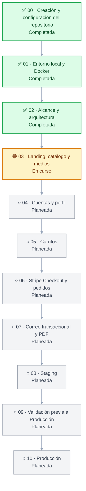

# Roadmap

Este roadmap fija la secuencia, dependencias, resultados y comprobaciones de cada fase. El alcance maestro del MVP está en [MVP_SCOPE.md](MVP_SCOPE.md). Las guías operativas de arquitectura y proveedores se preparan en las fases que las necesitan; su presencia futura no acredita que un servicio esté configurado.

Las reglas duraderas del repositorio están en [AGENTS.md](../AGENTS.md). El alcance maestro y las decisiones transversales se recogen en la fase 02; cada contrato de módulo se revisa al iniciar su fase funcional. El CI mínimo se prepara en la fase 01 y la guía de validación integral (`docs/quality/QUALITY-AND-RELEASE.md`) en la fase 09. Este documento organiza ese trabajo por fase.

| Fase | Resultado | Estado |
|---|---|---|
| 00 · Creación y configuración del repositorio | Repositorio GitHub, ramas y documentación inicial | Completada |
| 01 · Entorno local y Docker | Stack reproducible en Compose, con acceso local y opción LAN | Completada |
| 02 · Alcance y arquitectura | Alcance maestro y arquitectura transversal; los contratos de módulo se detallan en sus fases | Completada |
| 03 · Landing, catálogo y medios | Catálogo, presentación, medios y carga pública | En curso |
| 04 · Cuentas y perfil | Registro, confirmación, sesión, recuperación y perfil | Planeada |
| 05 · Carritos | Carrito de invitado, cuenta y transferencia | Planeada |
| 06 · Stripe Checkout y pedidos | Compra, webhook firmado, pedidos e idempotencia | Planeada |
| 07 · Correo transaccional y PDF | Resend, mensajes de compra y detalle de pedido | Planeada |
| 08 · Staging | Railway, integraciones aisladas y aceptación de recorridos | Planeada |
| 09 · Validación previa a Producción | CI, recorridos de navegador, accesibilidad, rendimiento, seguridad y operación | Planeada |
| 10 · Producción | Dominio público, medios, costos, operación y salida autorizada | Planeada |

## Secuencia

**Estados:** ✅ Completada · 🟠 En curso o verificación · ○ Planeada. Las fases activas tienen fondo ámbar y las planeadas, fondo gris; al completar una fase, se marca con ✅ y fondo verde.

## Plan por fases

### 00. Creación y configuración del repositorio — completada

- **Objetivo:** crear `sadamlg/sr_del_mictlan` en GitHub y su copia local, con documentación y configuración inicial del proyecto.
- **Dependencias:** acceso autorizado a la cuenta `sadamlg`; comprobar que el nombre esté disponible y revisar los ajustes actuales antes de reproducirlos. La visibilidad, permisos y opciones deben comprobarse en GitHub, no suponerse.
- **Resultado:** repositorio GitHub público, ramas `develop` y `main`, `develop` como predeterminada, eliminación automática de ramas fusionadas y documentación inicial aprobada. El `.gitignore` excluye secretos, datos personales y artefactos.
- **Medios y licencias:** `docs/architecture/ARCHITECTURE.png` es el diagrama de arquitectura incluido (PNG, 1536 × 1024; SHA-256 `88f174853e52fcebbd0c39c971480632fb20b3f5fecab0ab0e2f8867cfd24520`). No se incluyen fuentes ni código de aplicación. No se agregó archivo de licencia ni se eligió una licencia.
- **Comprobaciones:** el 12 de noviembre de 2026 se comprobó en GitHub el propietario y nombre `sadamlg/sr_del_mictlan`, la visibilidad pública, el acceso (sin colaboradores; sólo el propietario puede contribuir), las ramas `main` y `develop`, `develop` como rama predeterminada y la eliminación automática de ramas fusionadas. Cada rama tiene una regla de protección que requiere pull request, aplica a administradores y bloquea force-push y eliminación. No se requieren aprobaciones ni checks de estado.
- **Estado de CI y checks:** `main` y `develop` contienen el baseline `015a0cd`; no existe un workflow de GitHub Actions y no hay checks obligatorios configurados. La fase 01 implementará y verificará el CI mínimo y configurará como obligatorios únicamente los checks comprobados.
- **Estado y evidencia:** completada. Verificación de la configuración en GitHub web el 12 de noviembre de 2026. El commit raíz `015a0cd` (`docs: establish repository baseline`) está publicado en `main` y `develop`. El PR #1 se cerró sin fusionar y su rama se eliminó; por tanto, no cambió el baseline de `develop`. La documentación de este cierre se propone en un PR nuevo hacia `develop`.

### Cuándo se definen los contratos

La fase 02 aprueba el alcance maestro del MVP, la arquitectura transversal, las interfaces compartidas y la secuencia de dependencias. **No cierra por adelantado el comportamiento detallado de cada módulo.** Al iniciar cada fase funcional, se revisa y ajusta su contrato antes de implementar; el contrato guía su alcance y comprobaciones. Los documentos en <code>docs/contracts</code> describen el comportamiento previsto, no acreditan que ya esté implementado o validado. Las fases 03–07 enlazan el contrato correspondiente. Las fases de infraestructura, como Staging y Producción, actualizan las guías de proveedor que les corresponden.

### 01. Entorno local y Docker — completada

- **Objetivo:** permitir que una copia limpia del repositorio levante el stack de desarrollo y sus dependencias sin instalar Node.js en el equipo anfitrión.
- **Dependencias:** fase 00 completada.
- **Resultado:** Next.js con Tailwind CSS 4, API Express, PostgreSQL, Prisma, worker base y Mailpit en Docker Compose. El modo local enlaza puertos al loopback; el modo LAN es opcional y reversible y abre sólo frontend, API y la bandeja web de Mailpit. El worker registra un latido en PostgreSQL y tiene un comando SMTP de comprobación; el procesamiento de trabajos de correo corresponde a su fase.
- **CI del proyecto:** `.github/workflows/ci.yml` ejecuta pruebas y ESLint en frontend y backend, construye Next.js y valida/genera Prisma. El PR #3 confirmó en GitHub los checks `Frontend checks` y `Backend checks`; ambos aprobaron. Las reglas actuales de `develop` y `main` no requieren checks y no se modificaron. La fase 09 añade la validación integral en Staging y prepara `docs/quality/QUALITY-AND-RELEASE.md`.
- **Comprobaciones:** reconstruir y levantar Compose desde la guía; comprobar health checks, comunicación SSR frontend/backend, consulta de PostgreSQL, migración inicial en una base vacía, latido del worker, entrega SMTP a Mailpit, pruebas, lint y build. Para LAN, comprobar los enlaces desde la IPv4 anfitriona, restaurar el loopback y, si hay otro dispositivo disponible, confirmar acceso desde ese equipo. La guía distingue el entorno local de los Dockerfiles de producción que se preparan en la fase 08.
- **Estado y evidencia local — 12 de noviembre de 2026:** implementación verificada en Linux x86_64 con Docker Engine 29.9.2 y Compose 5.6.1; Node.js 24.21.0 se ejecutó en contenedores. Construyeron las imágenes del backend y frontend. `docker compose up --detach --wait` dejó PostgreSQL 18.6, Mailpit 1.31.5, backend, worker y frontend saludables. `/health` devolvió HTTP 200 con PostgreSQL conectado; `/api/hello` respondió y la página SSR mostró la respuesta del backend. Prisma validó el esquema; `migrate status` informó el esquema al día. La migración `20261112090000_initial` se aplicó y verificó en una base temporal vacía. El worker escribió un latido reciente. El comando de correo del worker envió el mensaje `Prueba local de Mailpit`, confirmado por la API de Mailpit. Pasaron 4 pruebas backend, 3 frontend, ambos lint y `npm audit` informó cero vulnerabilidades en ambos paquetes. El primer build manual de Next.js falló durante el prerender porque Compose y el Dockerfile imponían `NODE_ENV=development` también a `next build`. Se retiró esa asignación del servicio y de la imagen frontend: `next dev` y `next build` seleccionan sus modos automáticamente. La compilación optimizada volvió a pasar desde Compose sin definir `NODE_ENV`. Con autorización para acceder al daemon local, se recreó después el servicio frontend; el contenedor quedó saludable, el entorno del contenedor dejó `NODE_ENV` sin definir y la página respondió HTTP 200 con el comando `next dev`.
- **CI de GitHub — 13 de noviembre de 2026:** el PR #3 (`feat: establish phase 01 development infrastructure`) se fusionó en `develop` con el merge commit `e304693ca5aa215fe44b6594639e7af78d7c3a7b`. Los checks `Frontend checks` y `Backend checks` aprobaron. El primero ejecutó pruebas, ESLint y build de Next.js; el segundo ejecutó pruebas, ESLint, validación del esquema y generación de Prisma Client.
- **LAN — evidencia:** `scripts/dev-lan.sh up 192.168.100.2` publicó frontend, API y Mailpit en `0.0.0.0`; respondieron desde la IPv4 del anfitrión. El 12 de noviembre de 2026, el responsable confirmó que también verificó el acceso desde un segundo dispositivo y que funcionó. `scripts/dev-lan.sh off` restauró `127.0.0.1` y retiró `.env.dev-lan`.
- **GitHub y ramas — 12 y 13 de noviembre de 2026:** el 12 de noviembre, `develop` avanzó a `3c02a76` al fusionarse el PR #2 de fase 00. El 13 de noviembre, el PR #3 se fusionó en `develop` como `e304693ca5aa215fe44b6594639e7af78d7c3a7b`; GitHub eliminó la rama `feature/phase-01-infrastructure`. Las reglas de `main` y `develop` requieren pull request, aplican a administradores y bloquean force-push y eliminación; no requieren aprobación ni checks de estado. No se modificaron esas reglas.
- **Estado de fase:** completada. La implementación y las comprobaciones locales se registran con fecha 12 de noviembre de 2026; la ejecución satisfactoria de los dos checks y la fusión en `develop` se registran con fecha 13 de noviembre de 2026 y el commit `e304693ca5aa215fe44b6594639e7af78d7c3a7b`.

### 02. Alcance y arquitectura — completada

- **Objetivo:** validar el alcance maestro del MVP y definir la arquitectura transversal: cómo se comunican navegador, frontend, API y servicios externos antes de construir los módulos.
- **Dependencias:** fase 01.
- **Resultado:** alcance maestro en `docs/MVP_SCOPE.md`, reglas duraderas en [AGENTS.md](../AGENTS.md), decisiones transversales de arquitectura y secuencia de dependencias. En desarrollo, el navegador accede a la API por el puerto local publicado. En Staging y Producción usa el proxy del frontend (`/api/backend/*`), que reenvía a Express por la red privada; Stripe usa el endpoint público del webhook. El comportamiento detallado de cada módulo se define o ajusta en su fase, antes de implementar ese módulo.
- **Motivo y momento de validación:** definir y comprobar las rutas públicas, el proxy del frontend y la sesión antes de implementar cuentas; validar la integración desplegada en la fase 08.
- **Base de la fase:** `docs/MVP_SCOPE.md`, `docs/architecture/ROUTES-AND-ACCESS.md`, `docs/architecture/RENDERING-AND-SEO.md` y `docs/DESIGN.md` recogen el alcance, las rutas, el renderizado y el sistema visual adoptados para el proyecto; no acreditan capacidades implementadas. La explicación por entorno se integra en la sección de arquitectura existente del README. `docs/architecture/ARCHITECTURE.png` permanece intacto; el README distingue el hostname público de API para webhooks de la ruta de aplicación que usa el proxy del frontend.
- **Decisión confirmada por el responsable — 13 de noviembre de 2026:** la ruta prevista para medios de Producción es Cloudflare/R2. La fase 10 configura y verifica los hostnames y la entrega pública; esta decisión no afirma que existan ya un bucket, DNS o un proxy configurados.
- **Comprobaciones:** los diagramas, README y roadmap deben describir la misma arquitectura; las guías separarán las rutas locales y de producción; la API privada del navegador no se presentará como pública; cada fase funcional revisará su contrato antes de implementar. La integración desplegada se validará en la fase 08.
- **Estado y evidencia — 13 de noviembre de 2026:** completada como definición documental. El alcance, las rutas y el diseño se incorporaron en el commit `6bd3c13` y el PR #5 se fusionó en `develop` como `8c14d29f04cd19d32b76a62ddf08faf192b445e3`. La revisión de cierre comparó estos documentos con la referencia del proyecto y añadió la estrategia de renderizado y la interfaz de sesión. Se verificaron los enlaces locales y el diff documental; no se ejecutaron pruebas de funcionalidades futuras. Las capacidades de las fases 03–07, los proveedores y la integración desplegada siguen pendientes de implementación y verificación en sus fases.

### 03. Landing, catálogo y medios — en curso

- **Objetivo:** implementar la landing, el catálogo y los medios dentro del alcance aprobado.
- **Dependencias:** fases 01 y 02. Antes de cargar medios reales, el responsable del proyecto prepara la cuenta y el bucket no productivo de Cloudflare R2.
- **Contrato del módulo:** revisar y cerrar `docs/contracts/03-LANDING.md`, que reúne catálogo y contador de visitas, antes de implementar esas capacidades.
- **Preparación de fase:** el responsable confirmó que creó con ChatGPT las imágenes del sitio y que las entrega al cliente con autorización para publicarlas y alojarlas en R2. El bucket no productivo `sr-del-mictlan` ya está creado y tiene una URL pública de desarrollo. La integración local se configura con `MEDIA_BASE_URL`; las doce rutas directas, la API del catálogo y la landing en Compose se comprobaron el 14 de noviembre de 2026. Siguen pendientes las demás comprobaciones de cierre de la fase.
- **Resultado:** landing, tres fichas locales de catálogo, contador de visitas, aviso de edad e imágenes con claves estables. Desarrollo puede servir los archivos localmente o desde R2; staging usa medios no productivos; producción tendrá bucket y hostname propios. `r2.dev` se reserva para desarrollo/staging y no requiere cambiar DNS. La carga del MVP es manual; la aplicación no recibe credenciales de escritura. Cada entorno necesita sus migraciones; el catálogo de demostración se carga manualmente con `backend/prisma/dev-showcase.sql`.
- **Entrega y optimización de imágenes:** definir y comprobar qué superficies usarán el optimizador de Next.js y cuáles entregarán los originales. R2 no se considera un servicio de conversión de imágenes. Evaluar formatos, tamaños y transformaciones según el comportamiento que se implemente.
- **Precios del catálogo:** usar datos de prueba claramente separados de los precios comerciales. El responsable debe aprobar los precios finales antes de habilitar ventas reales.
- **R2 y entrega pública:** desarrollo puede servir archivos locales o usar el bucket no productivo mediante `MEDIA_BASE_URL`; staging debe usar medios no productivos. La guía [Cloudflare R2](architecture/services/R2.md) explica el flujo real del código y la configuración del entorno. El bucket no productivo ya entrega las doce imágenes por HTTPS; su URL está en el `.env` local, y Compose pasa esa base al frontend y al backend. Para producción se usará otro bucket y un dominio propio; la fase 10 configura y verifica el hostname y la entrega pública. R2 no transforma imágenes; cualquier servicio de optimización se evalúa por separado.

- **Presentación y entrega:** las animaciones de interfaz se resuelven con CSS donde corresponde y respetan `prefers-reduced-motion`; no se depende de archivos animados pesados si una animación CSS cubre el caso. El catálogo público tendrá una estrategia de renderizado, caché y metadatos; las rutas privadas no deben servirse desde caché pública. Stripe necesita imágenes públicas HTTPS al crear Checkout, mediante `STRIPE_MEDIA_BASE_URL` del entorno.
- **Comprobaciones:** la landing y los productos activos se muestran; las claves y metadatos resuelven el medio correcto en cada entorno; se comprueba el tratamiento de imágenes de cada superficie; el aviso de edad funciona; la interfaz respeta movimiento reducido; se comprueba que el proveedor de pago pueda obtener las imágenes cuando se usa Checkout remoto.
- **Estado y evidencia — 13 de noviembre de 2026:** fase iniciada desde `develop` en `3de958a`, tras la fusión del PR #6 y la aprobación de sus checks de frontend y backend. En el árbol de trabajo sin commit se implementaron el hero, escaparate, ritual, FAQ, aviso de edad y contador; se añadieron API, migración y datos de demostración locales. En la revisión inicial se verificó el SHA-256 del componente y del PNG del hero. En Compose se aplicó la migración, se cargaron las tres fichas en una base de catálogo vacía y pasaron 24 pruebas backend, 23 frontend, ambos lint y build con caché de catálogo. En navegador de escritorio se vio el hero, las fichas y el contador, se comprobó el aviso de edad y que el encabezado se oculta al bajar y reaparece al subir; en 390 px se comprobó la apertura y cierre del menú con Escape y retorno de foco. La consola de la sesión revisada no mostró errores ni advertencias. La revisión de archivos confirmó hero, ritual, FAQ, pie y contador; cuenta, carrito, botones de compra y checkout corresponden a fases posteriores. A esa fecha faltaban una revisión completa de tamaños y movimiento reducido, estados de error, autorización de recursos, R2 e integración desplegada. Esta evidencia corresponde al árbol sin commit; asociar un commit al completar la fase.
- **Revisión visual inicial — 13 de noviembre de 2026:** en el mismo navegador se revisaron escritorio (ventana medida de 1600 × 1000 CSS px) y móvil (433 × 937 CSS px). Se revisaron las dimensiones finales del hero, escaparate, ritual, FAQ y pie tras cargar el contenido; la ficha de Calios y la primera pregunta mostraron su contenido al activarlas. El encabezado midió aproximadamente 94 px en escritorio frente al objetivo de 110 px; su ajuste quedó pendiente para la siguiente revisión. El favicon de la aplicación todavía no estaba incorporado. Los accesos de cuenta, carrito y botones de compra no eran operativos por corresponder a fases posteriores. No se habían revisado exhaustivamente todos los tamaños, animaciones, hover, teclado, movimiento reducido ni estados vacíos o de error. En esa fecha R2 se dejó para el final de la fase por indicación del responsable.
- **Ajustes visuales y ampliación de comprobaciones — 13 de noviembre de 2026:** se ajustó el padding inferior del encabezado de escritorio para alcanzar 110 px y se incorporó el favicon. En el mismo navegador se revisaron cinco anchos solicitados (320, 390, 768, 1024 y 1440 px; el navegador informó 355, 433, 853, 1137 y 1600 CSS px respectivamente); se revisaron la geometría del hero y la altura del encabezado. Tras cargar el catálogo y cerrar el aviso, se revisaron las alturas de las secciones en las muestras móvil y de escritorio. En móvil se comprobó el menú, Escape y foco, y se abrió el detalle de Calios; la consola de la sesión no mostró errores ni advertencias. Los doce medios y el favicon devolvieron HTTP 200 localmente. Pasaron 23 pruebas frontend, 24 backend, ambos lint, build y validación de Prisma. A esa fecha no se habían verificado todos los estados de error, movimiento reducido ni todos los dispositivos; R2 y la autorización de recursos seguían pendientes. La evidencia corresponde al árbol sin commit.
- **Estados alternativos y carga diferida — 13 de noviembre de 2026:** en instancias temporales aisladas se comprobó el catálogo vacío, fallo de catálogo y recuperación mediante «Reintentar», fallo del contador con guion y fallo del PNG del hero con texto y acción visibles. Al simular una respuesta de catálogo lenta se detectó que el aviso de edad podía abrirse antes de que existiera el escaparate; se corrigió para esperar su inserción y observar su entrada en pantalla. Una prueba automatizada reproduce la inserción diferida y en navegador se comprobó el comportamiento con una respuesta retrasada, Escape y el ciclo de foco del aviso. En Compose pasaron 24 pruebas frontend y 24 backend, ambos lint, build y validación de Prisma. El CSS de movimiento reducido se revisó en código; no se emuló esa preferencia en navegador. En esa fecha, R2 y la autorización de recursos seguían pendientes. La evidencia corresponde al árbol sin commit.
- **R2 y autorización de recursos — 14 de noviembre de 2026:** el responsable confirmó la autoría de las imágenes creadas con ChatGPT y su entrega al cliente con permiso para publicarlas y alojarlas en R2. Confirmó que el bucket no productivo `sr-del-mictlan` está creado y compartió su URL pública de desarrollo; el valor se configuró en `MEDIA_BASE_URL` del `.env` local, ignorado por Git, y Compose resolvió ese valor tanto para backend como frontend. Las doce rutas directas abrieron en navegador: hero (1672 × 941 px), fondos de escritorio y móvil, tres pares de imágenes de catálogo (1122 × 1402 px), marca (1774 × 887 px), calavera (1254 × 1254 px) y etiqueta de agave (2172 × 724 px). Se recrearon frontend y backend; la API del catálogo respondió HTTP 200 con las seis URL de producto bajo R2, el optimizador de Next.js respondió HTTP 200 para Calios y la landing local presentó las tres fichas. Evidencia del entorno local el 14 de noviembre de 2026, en cambios sin commit.

### 04. Cuentas y perfil — planeada

- **Objetivo:** ofrecer registro, autenticación, recuperación y administración del perfil.
- **Dependencias:** fases 01 y 02; las pantallas se integran con las superficies definidas en fase 03.
- **Contrato del módulo:** revisar y cerrar `docs/contracts/04-ACCOUNTS-PROFILE.md` antes de implementar registro, sesión y perfil.
- **Resultado:** registro con validación de mayoría de edad y dirección; confirmación de correo; inicio, cierre y restauración de sesión; recuperación de contraseña; edición de nombre(s), apellidos, correo, fecha de nacimiento y dirección; perfil y Mis pedidos, conectado a órdenes reales en la fase 06. Los datos de cuenta se guardan en PostgreSQL. Las cuentas nuevas permanecen pendientes hasta consumir el enlace; un cambio de correo sólo se aplica tras confirmar el nuevo destino. Confirmar puede iniciar sesión y, si la persona venía de comprar, retomar el carrito y el resumen de compra.
- **Correo local:** probar mensajes de cuenta con el worker y Mailpit en Compose. El envío desde un dominio real se prepara en la fase 07; no se requiere Resend para desarrollar las cuentas localmente.
- **Turnstile por entorno:** usar claves de prueba para desarrollo local; la fase 08 configura y verifica un widget y claves de Staging, y la fase 10 prepara un widget y claves separados para Producción antes de abrir el sitio. La API valida los tokens en todos los entornos; no se expone la clave secreta al frontend.
- **Sesión y estados de interfaz:** producción usa el proxy del frontend definido en fase 02 para conservar la cookie bajo el origen de la tienda. Comprobar confirmación e inicio desde otro dispositivo; no asumir que confirmar correo en un dispositivo inicia sesión en otro. Si se abandona la vista de revisión de correo y se vuelve al login, la interfaz debe reflejar el estado real de la cuenta y permitir iniciar sesión después de confirmarla, sin conservar un mensaje de registro obsoleto.
- **Comprobaciones:** registro pendiente y confirmado, login, restauración, recuperación, cambio de correo confirmado, validaciones del backend, estados de carga/error/sesión vencida y privacidad de contraseñas y tokens. En Compose verificar los mensajes en Mailpit.
- **Estado y evidencia:** planeada; registrar pruebas, entorno, fecha y commit al completar la fase.

### 05. Carritos — planeada

- **Objetivo:** permitir preparar una compra como invitado o con cuenta y fusionar ambos carritos al iniciar sesión.
- **Dependencias:** fases 03 y 04.
- **Contrato del módulo:** revisar y cerrar `docs/contracts/05-CARTS.md` antes de implementar el carrito persistente y la fusión de carritos. La integración del pago con Stripe se especifica en el contrato de la fase 06.
- **Resultado:** carrito de invitado persistido en el navegador por 30 días y carrito de cuenta en PostgreSQL. La transferencia suma cantidades de forma idempotente; el backend calcula precios actuales. Los productos inactivos se pueden quitar, pero no comprar. No se reservan ni verifican existencias.
- **Sincronización con Checkout:** al confirmar un pago, el webhook elimina sólo las líneas que coinciden con la instantánea comprada. Si la persona cambia el carrito mientras Stripe Checkout está abierto, esos cambios se conservan. Esta dependencia se implementa y valida junto al flujo de pago de la fase 06.
- **Comprobaciones:** reintentar la fusión no duplica cantidades, un error conserva el carrito local, se muestra un único carrito y Checkout rechaza productos inactivos o precios inválidos.
- **Estado y evidencia:** planeada; registrar pruebas, entorno, fecha y commit al completar la fase.

### 06. Stripe Checkout y pedidos — planeada

- **Objetivo:** aceptar pagos alojados por Stripe y confirmar las compras sólo mediante webhooks firmados.
- **Dependencias:** fases 03, 04 y 05.
- **Contrato del módulo:** revisar y cerrar `docs/contracts/06-CHECKOUT-ORDERS.md` antes de implementar pagos, webhooks y órdenes.
- **Stripe local:** primero probar en modo de prueba desde Compose con Stripe CLI y un túnel hacia el endpoint local. Reenviar sólo los eventos que procesa la aplicación y usar el `whsec_…` entregado por esa sesión local. La guía de Stripe se preparará en esta fase.
- **Resultado:** el servidor vuelve a validar disponibilidad y precios, crea una instantánea pendiente y abre Stripe Checkout. El webhook firmado confirma pagos, guarda la orden histórica y limpia las líneas compradas de forma idempotente. Sólo se muestran pedidos pagados a su titular. El resumen permite cambiar el destinatario sin alterar el perfil, consultar datos seguros de tarjetas guardadas y volver a pedir. No se almacena el número completo ni el CVC de la tarjeta.
- **Stripe en staging:** al desplegar en la fase 08, crear en el dashboard de Stripe un webhook HTTPS dirigido al dominio público de la API y `/api/webhooks/stripe`. Configurar los eventos documentados y guardar su secreto `whsec_…` en el backend de staging. Las claves y secretos de staging no se comparten con el túnel ni con producción.
- **Comprobaciones:** precios y disponibilidad vigentes, firma válida e inválida, eventos repetidos, estado pagado determinado por webhook y no por el retorno del navegador, orden visible en Mis pedidos y limpieza del carrito sin perder ediciones realizadas durante Checkout.
- **Estado y evidencia:** planeada; registrar pruebas, entorno, fecha y commit al completar la fase.

### 07. Correo transaccional y PDF — planeada

- **Objetivo:** entregar mensajes de cuenta y una confirmación de compra con un único PDF de detalle del pedido.
- **Dependencias:** fase 04 para mensajes de cuenta y fase 06 para pedidos pagados. Antes de habilitar envíos desde un dominio propio, el responsable del proyecto crea la cuenta de Resend y prepara el dominio de envío en el DNS autoritativo elegido.
- **Contrato del módulo:** la fase 04 define el correo de cuenta en `docs/contracts/04-ACCOUNTS-PROFILE.md`; la fase 06 define el correo de compra/PDF en `docs/contracts/06-CHECKOUT-ORDERS.md`. Revisar esos criterios antes de implementar la entrega en esta fase. La integración y los límites del proveedor se documentan en una guía preparada en la fase 07.
- **07.1 · Verificar el flujo local:** probar registro, recuperación y compra desde Compose; Mailpit debe recibir tanto correo de cuenta como de compra y el correo de compra debe incluir el PDF. Confirmar reintentos, tratamiento de fallos e idempotencia sin depender de un proveedor remoto.
- **07.2 · Preparar dominio y remitentes:** añadir en el Zone Editor los registros exactos que muestre Resend para el dominio remitente elegido, comprobar la verificación y preservar los MX y registros de otros servicios. No usar la sección de child nameservers para crear TXT/CNAME/MX ni cambiar toda la delegación DNS para verificar un registro. La guía del proveedor se preparará en esta fase.
- **07.3 · Revisar capacidad de envío:** comprobar en la cuenta el plan, límites y precios vigentes antes de configurar envíos. Confirmación, recuperación y compras comparten esos límites. No habilitar sobreconsumos ni agregar un método de pago sin presupuesto aprobado. La guía de Resend se preparará en esta fase.

- **Resultado:** PostgreSQL persistirá un solo trabajo de confirmación por pedido pagado y el worker lo procesará. En Compose, el worker usará SMTP hacia Mailpit; en Railway, usará la API HTTPS de Resend. La clave pertenecerá al Worker y se separará por entorno. `MAIL_FROM` se usará para mensajes de cuenta y `RESEND_FROM` para compras. No se añadirá otro broker a la cola persistida. El worker registrará tipo de trabajo, intento y error sin volcar destinatarios, domicilios ni contenido del mensaje.
- **Comprobaciones:** dominio verificado, remitentes autorizados, enlaces con el origen del entorno correcto, mensaje visible en Resend y en la bandeja destino, PDF con el detalle correcto y trabajo recuperable ante fallos. No guardar claves en el repo ni configurarlas como `SMTP_PASSWORD`.
- **Estado y evidencia:** planeada; registrar pruebas, entorno, fecha y commit al completar la fase.

### 08. Staging — planeada

- **Objetivo:** desplegar y aceptar la aplicación en servicios no productivos que reproduzcan la arquitectura de producción.
- **Dependencias:** fases 01–07; cuenta Railway del responsable del proyecto, PostgreSQL de staging, Dockerfiles de producción, bucket de medios no productivo, claves de Stripe de prueba y configuración de Worker/Resend de staging. El responsable crea un widget Turnstile de staging y autoriza el hostname público del frontend antes de añadir sus claves a Railway; no requiere migrar DNS ni activar un proxy Cloudflare. Confirmar que los Dockerfiles estén versionados antes de crear los servicios.
- **08.1 · Crear servicios Railway:** configurar `postgres`, `api`, `worker` y `frontend` por separado. Usar `backend/Dockerfile.production` para API y Worker y `frontend/Dockerfile.production` para Next.js; ejecutar migraciones desde el servicio API. La guía indica raíz, comandos, health check, red privada y variables. `INTERNAL_API_URL` permite que Next.js use la URL privada de la API; su dominio público recibe el webhook. No desplegar Mailpit.
- **08.2 · Aislar proveedores y medios:** cada servicio conserva variables y secretos propios de staging. Usar webhook HTTPS de Stripe con su propio secreto, bucket/hostname no productivo y remitentes de Resend verificados. Los dominios públicos de Railway bastan para iniciar; Cloudflare DNS/TLS para un dominio de staging sólo se configura si ese dominio está disponible y se necesita.
- **08.3 · Revisar el consumo de Railway:** inspeccionar el control de uso a nivel del workspace y dejar documentado si existen alerta suave y límite duro. El umbral se decide según presupuesto aprobado; no asignarlo por intuición. Registrar el alcance y el comportamiento observado en la guía de Railway que se preparará en esta fase.
- **08.4 · Completar controles del MVP:** verificar Turnstile en registro e inicio de sesión, validación Siteverify de token, hostname y acción, y casos válidos e inválidos. Configurar claves y hostname propios con las guías de Cloudflare y Railway preparadas para esta fase.
- **Comprobaciones de recorrido completo:** desde móvil y escritorio, registrar, recibir y consumir confirmación, iniciar sesión, recuperar contraseña, consultar catálogo/imágenes, preparar carrito, pagar con Stripe de prueba, confirmar por webhook, comprobar que se limpia sólo lo comprado y recibir el correo con PDF. Revisar también errores de consola y solicitudes; una prueba de compra aislada no acredita todos estos recorridos.
- **Estado y evidencia:** planeada; registrar pruebas, entorno, fecha y commit al completar la fase.

### 09. Validación previa a Producción — planeada para el proyecto

- **Objetivo:** obtener evidencia reproducible de calidad funcional, accesibilidad, rendimiento, seguridad y recuperación del candidato antes de abrir Producción.
- **Dependencias:** reconstrucción verificada de las fases 01–08 en el proyecto; CI básico preparado desde el inicio; Staging desplegado con commit identificable y proveedores de prueba. El responsable prepara antes de las pruebas cuentas/bandejas de prueba, acceso administrativo a GitHub/Railway y recursos aislados de PostgreSQL, Stripe, Resend y Cloudflare. Revisar cuotas y presupuesto antes de activar servicios adicionales.
- **Resultado:** suites de Playwright y axe, informes Lighthouse y ZAP Baseline, revisión de seguridad, checks de GitHub Actions y evidencia de restauración/rollback. Las herramientas se ejecutan desde el equipo o runners temporales; Playwright no requiere un servicio permanente en Compose. La guía `docs/quality/QUALITY-AND-RELEASE.md`, que se preparará en esta fase, definirá el paquete obligatorio, complementos opcionales, orden y fuentes.
- **Comprobaciones:** lint, pruebas y build aprobados; recorridos críticos reales de Staging documentados; accesibilidad automática y manual revisada; mediciones de rendimiento y SEO guardadas con objetivos acordados; hallazgos altos/críticos confirmados resueltos; restauración, alertas y rollback comprobados. Asociar resultados al mismo candidato y distinguir simulaciones, omisiones y bloqueos. Registrar responsable y aceptación antes de avanzar a la fase 10.
- **Estado y evidencia:** planeada; registrar pruebas, entorno, fecha y commit al completar la fase.

### 10. Producción — planeada

- **Objetivo:** preparar el entorno real, su dominio público, operación y costos antes de autorizar la salida.
- **Dependencias:** aceptación de staging y cierre de la fase 09 en el proyecto, cuenta y recursos de producción, dominio disponible y preparación por el responsable del proyecto de credenciales distintas para Stripe, Resend, Railway, R2 y Turnstile.
- **10.1 · Preparar Railway y medios:** crear servicios y PostgreSQL separados de staging, aplicar migraciones, verificar catálogo, configurar Worker/Resend, claves de Stripe live y bucket de producción. Preparar un widget Turnstile de Producción con su hostname y claves independientes de Staging; el secreto pertenece sólo a la API. Obtener aprobación de los precios comerciales antes de habilitar cobros reales. La URL de medios debe ser pública y HTTPS para Stripe; no usar <code>r2.dev</code> en producción.
- **10.2 · Configurar y verificar la entrega pública de medios Cloudflare/R2:** preparar el hostname de medios de Producción y comprobar HTTPS y entrega de imágenes de producto antes de crear sesiones de Stripe. R2 y la zona DNS son recursos distintos: usar R2 en desarrollo o Staging no requiere cambiar nameservers. Verificar DNS y proxy/CDN de la tienda y la API al preparar la capa pública. Si se migra una zona, inventariar y conservar antes los registros web, MX, SPF, DKIM, DMARC y verificaciones; cambiar la delegación afecta toda la zona. Probar TLS, tienda, webhook, imágenes y políticas de caché antes de habilitar el tráfico. Preparar las guías de proveedor correspondientes.
- **10.3 · Revisar cuotas, límites y costos antes de habilitar tráfico:**
  - **R2 y Cloudflare Images:** verificar cuotas, precios, facturación y alcance de alertas en las cuentas. R2, CDN y transformaciones de imágenes son opciones separadas; incluir sólo las seleccionadas y presupuestadas.
  - **Railway:** revisar alcance, límites de consumo y efecto de cada control sobre los workloads del workspace. Seleccionar umbrales sólo con presupuesto aprobado.
  - **Resend:** comparar el volumen diario y mensual de confirmación, recuperación y compras con el plan disponible. Confirmar límites, cargos por excedentes y requisitos de facturación antes de habilitar el envío.
  - **Stripe:** verificar tarifas, límites y controles disponibles en la cuenta. El modo de prueba no procesa pagos reales; un límite de solicitudes API no es un límite de gasto o ventas. Definir cualquier límite de ventas como regla del negocio antes de producción.
  - Registrar los umbrales y el responsable sólo después de revisar los paneles de cada cuenta y aprobar un presupuesto. Las guías de proveedor de esta fase documentarán los controles aplicables.

- **10.4 · Preparar operación y salida:** configurar copias de seguridad y comprobar recuperación, monitoreo, responsables de secretos, respuesta a fallos y procedimiento de rollback. Completar dominio canónico, metadatos, `robots.txt` y `sitemap.xml` antes de abrir el sitio a indexación, según la estrategia SEO aprobada.
- **Comprobaciones:** repetir en producción las integraciones críticas con las credenciales y recursos de ese entorno; verificar correo, imágenes y enlaces bajo dominio final; revisar restauración y costos; obtener autorización explícita antes de habilitar ventas.
- **Estado y evidencia:** planeada; registrar pruebas, entorno, fecha y commit al completar la fase.
