# Roadmap

Este documento resume el resultado principal y la aceptación de cada fase, junto con decisiones y riesgos que afectan el lanzamiento. No es una bitácora de herramientas, cambios ni implementaciones. Los procedimientos reproducibles viven en las guías enlazadas; aquí conservamos sólo evidencia de alto impacto que explica una decisión o bloquea la aceptación.

El alcance aprobado está en [MVP_SCOPE.md](MVP_SCOPE.md), las decisiones transversales en [AGENTS.md](../AGENTS.md) y el comportamiento de cada módulo en sus contratos de `docs/contracts/`.

| Fase | Resultado | Estado |
|---|---|---|
| 00 · Repositorio | GitHub y base documental | Completada |
| 01 · Entorno local y Docker | Stack local reproducible y CI básico | Completada |
| 02 · Alcance y arquitectura | Alcance MVP y contratos transversales | Completada |
| 03 · Landing, catálogo y medios | Tienda pública y entrega de imágenes | Completada |
| 04 · Cuentas y perfil | Registro, sesión y administración de cuenta | Completada |
| 05 · Carritos | Carrito de invitado y cuenta | Completada |
| 06 · Checkout y pedidos | Pagos Stripe y órdenes confirmadas por webhook | Completada |
| 07 · Correo y PDF | Worker y mensajes transaccionales | Implementación local completada; integración externa validada en fase 08 |
| 08 · Staging | Despliegue e integración de proveedores | Completada; Railway Staging activo |
| 09 · Validación previa a Producción | Aceptación de calidad, seguridad y recuperación | En curso |
| 10 · Producción | Entorno público y salida autorizada | Planeada |

## Secuencia

```mermaid
flowchart LR
    p00["00 Repositorio"] --> p01["01 Docker y CI"] --> p02["02 Alcance y arquitectura"] --> p03["03 Tienda y medios"] --> p04["04 Cuentas"] --> p05["05 Carritos"] --> p06["06 Checkout y pedidos"] --> p07["07 Correo y PDF"] --> p08["08 Staging"] --> p09["09 Validación"] --> p10["10 Producción"]
```

## Hitos y alcance por fase

### 00. Repositorio — completada

- Repositorio público `sadamlg/sr_del_mictlan` con ramas `develop` y `main` y documentación base del proyecto.

### 01. Entorno local y Docker — completada

- Compose levanta Next.js, API Express, PostgreSQL, Prisma, Worker y Mailpit; CI cubre pruebas, ESLint, build y validaciones de Prisma.

### 02. Alcance y arquitectura — completada

- `docs/MVP_SCOPE.md` define el MVP y el repositorio establece sus decisiones transversales. Cada módulo concreta su contrato en la fase correspondiente.
- El navegador usa el proxy del Frontend hacia la API privada en entornos remotos; Stripe entrega webhooks al Backend por HTTPS.

### 03. Landing, catálogo y medios — completada

- La tienda contiene landing, tres fichas de catálogo, aviso de edad y contador de visitas. R2 aloja los medios públicos; la aplicación no necesita credenciales de escritura.
- La carga de medios es manual; Staging y Production mantienen buckets separados y Production usa un hostname propio.

### 04. Cuentas y perfil — completada

- Registro con validación de edad, confirmación por correo, inicio y restauración de sesión, recuperación de contraseña, perfil y Mis pedidos. La API valida Turnstile; la clave secreta permanece en Backend.
- El proxy del Frontend conserva la sesión y las cuentas se activan al confirmar el correo.

### 05. Carritos — completada

- Hay carritos de invitado y de cuenta. La transferencia es idempotente, el backend aplica precios actuales y no se reservan existencias.
- El webhook de pago elimina sólo las líneas compradas y conserva los cambios concurrentes del carrito.

### 06. Stripe Checkout y pedidos — completada

- La API crea sesiones alojadas de Checkout y confirma pedidos sólo mediante webhooks firmados. El procesamiento es idempotente y no almacena el número completo ni el CVC.
- La compra local usa el sandbox de Stripe. El backend confirma pedidos sólo mediante webhooks firmados e idempotentes; la aplicación no almacena datos completos de tarjeta.

### 07. Correo transaccional y PDF — implementación local completada

- PostgreSQL mantiene la cola transaccional; el Worker procesa confirmaciones de cuenta, recuperación y compras con PDF.
- Compose usa Mailpit de forma predeterminada; Resend local es opcional y Staging confirma la entrega externa. La [guía de Resend](architecture/services/RESEND.md) explica los perfiles y la separación de credenciales.

### 08. Staging — completada

- Railway integra PostgreSQL, Backend, Worker y Frontend con los proveedores externos. En Staging aceptamos registro, correo, Turnstile, sesión, recuperación de contraseña y compra de prueba con Stripe; no se procesan pagos reales. La [guía de Railway](architecture/services/RAILWAY.md) contiene el procedimiento de despliegue.
- `srmictlan.com` conecta el dominio al Frontend de Staging y no representa Production. Antes de validar, confirmamos que el dominio y el despliegue pertenecen al entorno elegido.

### 09. Validación previa a Producción — en curso

**Resultado de fase:** El pipeline de CI cubre controles funcionales, accesibilidad automatizada, auditoría de dependencias, integración de base de datos y la restauración cifrada de un respaldo sintético. La validación local de producción confirma CSP, navegación, indexación y estilos móviles; falta que los checks del commit candidato pasen y aceptar ese candidato en Staging, además de cerrar los controles operativos externos.

- Staging conserva pagos en modo de prueba y requiere no indexación. Antes de aceptar el dominio, verificamos que los cuatro servicios estén disponibles y que la respuesta efectiva mantenga esa política.
- CI ejecuta auditoría de dependencias, pruebas, lint, build, Playwright/axe, integración PostgreSQL y restauración cifrada sintética. El límite de cuentas se separa por identidad mediante HMAC para que clientes detrás del proxy interno no compartan cuota; Cloudflare aplica además un límite breve por IP a las rutas de cuenta. Backend usa una réplica; si escala, el contador en memoria requiere almacenamiento compartido.
- La revisión pasiva no confirmó hallazgos críticos o altos; queda revalidar el candidato desplegado. CI aplica CSP y el build local confirma hashes/nonces sin perder prerenderizado; la prueba de navegador verifica la política y un Turnstile simulado. Falta validar el SHA desplegado de Staging con el CAPTCHA real. La revisión pasiva no sustituye una prueba de penetración completa.
- La línea base móvil de Lighthouse es 69/100 y 14.31 s de LCP. El recurso principal móvil bajó de 2.24 MB a 167 KB en WebP, con PNG de respaldo. La meta de aceptación es mediana ≥90/100 y LCP mediano ≤2.5 s; falta medir tres ejecuciones del candidato desplegado.
- El job `pg_dump` cifra, sube, vuelve a descargar y restaura un dataset sintético en R2/S3Mock. Antes de respaldar datos reales faltan el Cron diario, un bucket privado y credenciales acotadas, la retención, la alerta de Healthchecks.io y medir el RTO.
- La aceptación de accesibilidad requiere completar zoom real al 200% y navegación con lector de pantalla.

### 10. Producción — planeada

Preparar Production con recursos, base, credenciales y medios independientes; completar la restauración demostrada y aceptar los controles de calidad. Seguir el [runbook maestro de Producción](operations/PRODUCTION-RUNBOOK.md). Habilitar dominio, indexación y pagos reales sólo después de las puertas de salida y la autorización correspondiente.
