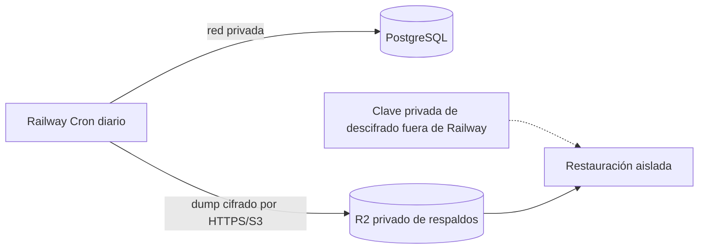

# Respaldo y restauración PostgreSQL con `pg_dump`

## Arquitectura de respaldo

Nuestro diseño conserva copias lógicas de PostgreSQL fuera del producto de respaldos de Railway, con una cadencia de **una copia cada 24 horas**. Cada archivo se cifra y se almacena en un bucket privado de R2. Restauramos con herramientas estándar de PostgreSQL y credenciales de recuperación custodiadas fuera de Railway y R2.

El job `database-backup` se ejecuta como servicio Cron en Railway, dentro del proyecto y entorno de Production. Los archivos permanecen fuera del producto de respaldos de Railway, aunque la generación de nuevas copias depende de la ejecución del job. Si Railway no está disponible, descargamos las copias ya almacenadas en R2 desde otro entorno con credenciales autorizadas.

## Arquitectura y operación

1. Ejecutar `database-backup` como servicio de tarea corta cuyo comando finaliza al completar; el Worker de correo conserva su función de procesamiento de mensajes.
2. Programar el job a las 08:00 UTC todos los días (`0 8 * * *`). Railway Cron usa UTC, puede iniciar con variación de minutos y omite una ejecución si la anterior continúa activa; mantenemos el job breve y con estado verificable. [Railway Cron](https://docs.railway.com/cron-jobs)
3. Conectarlo a PostgreSQL mediante el hostname privado del mismo proyecto y entorno. No habilitar un TCP Proxy público para el respaldo; la red privada evita exponer la base y el egress público de la conexión a PostgreSQL. [Red privada Railway](https://docs.railway.com/networking/private-networking/how-it-works), [PostgreSQL Railway](https://docs.railway.com/databases/postgresql)
4. Ejecutar un `pg_dump` en formato custom (`-Fc`) con una versión de cliente fijada al mismo major que PostgreSQL de Production. El formato custom permite restaurar selectivamente con `pg_restore`; el dump es consistente mientras la base recibe escrituras normales. `pg_dump` cubre una base, no los roles globales del clúster. [pg_dump](https://www.postgresql.org/docs/current/app-pgdump.html), [formatos de respaldo](https://www.postgresql.org/docs/current/backup-dump.html)
5. Cifrar el archivo antes de subirlo, por ejemplo con `age` y una clave pública de cifrado. Guardar la clave privada de descifrado fuera de Railway y R2, con acceso de recuperación documentado. No ponerla en el repositorio, logs, imagen Docker o servicio Cron.
6. Subir el archivo cifrado mediante S3 API a un bucket R2 **privado dedicado**, separado del bucket público de imágenes. Crear una credencial R2 limitada a ese bucket y a las operaciones requeridas; el servicio de aplicación no recibe esas credenciales. [Credenciales S3 de R2](https://developers.cloudflare.com/r2/get-started/s3/)
7. Usar una ruta determinista por fecha, por ejemplo `postgres/production/YYYY/MM/DD/database-YYYYMMDDTHHmmssZ.dump.age`. No incluir datos de usuario en nombre de archivo, etiquetas o logs.
8. Retener 30 copias diarias mediante una regla de ciclo de vida de R2. Estimar el costo con el tamaño real y el consumo medido antes de habilitar el job; la expiración de objetos puede tardar en aplicarse. [Lifecycle de R2](https://developers.cloudflare.com/r2/buckets/object-lifecycles/)

## Costos y límites operativos

- Railway Cron está disponible en el plan Hobby según la [página de planes](https://railway.com/pricing); el job consume recursos de ejecución y la transferencia hacia R2 cuenta en el egreso de Railway. Esta estrategia evita depender exclusivamente de los backups nativos, pero no garantiza costo cero.
- El tráfico entre servicios de una red privada Railway no se factura como egress público; al guardar el dump en R2 sí hay transferencia saliente desde Railway.
- R2 Standard incluye cuotas de almacenamiento y operaciones; el almacenamiento que excede la cuota puede tener costo. La salida de datos desde R2 no tiene costo según la [tabla de precios de R2](https://developers.cloudflare.com/r2/pricing/).
- Medir el tamaño comprimido de un dump real antes de estimar el costo. Para 30 días, estimar aproximadamente suma de tamaños retenidos más operaciones; no asumir que el límite gratuito cubre la base completa.
- Revisar las cuotas, alertas, cargos y costo de almacenamiento de Railway y Cloudflare antes de habilitar cada entorno.

## Comprobaciones de cada ejecución

El job:

- falla ante cualquier error de `pg_dump`, cifrado o transferencia y devuelve estado no exitoso;
- escribe en almacenamiento temporal, valida y sube sólo el archivo terminado; limpia el temporal también si falla;
- comprueba que el archivo se puede listar con `pg_restore --list` antes de cifrarlo/subirlo y calcula SHA-256 para validar el objeto al subirlo y descargarlo;
- excluye de logs URL con credenciales, DSN, nombres de tablas/filas, PII, salida SQL, claves y datos de correo;
- emite sólo fecha de ejecución, duración, bytes, resultado y checksum, y conserva un indicador de la última copia correcta;
- alerta ante un fallo o cuando no aparece una copia válida en 26 horas.

Una copia válida no demuestra por sí sola que podamos recuperarla. Comprobamos una restauración completa aislada antes de almacenar datos reales y después hacemos un simulacro mensual.

## Restauración y protección de datos

1. Elegir un entorno aislado y vacío, fuera de la base activa. No ejecutar `pg_restore` contra Production como prueba.
2. Obtener un objeto de R2, verificar su checksum y descifrarlo usando la clave privada protegida fuera de Railway.
3. Preparar PostgreSQL compatible con la versión de Production y los roles necesarios. `pg_dump` no incluye los roles globales; documentar su recreación con permisos mínimos y credenciales nuevas, no guardar contraseñas en el dump de configuración.
4. Restaurar con `pg_restore --exit-on-error` en la base aislada; comprobar migraciones esperadas, conteos/registro sintético conocido, consultas de lectura y salud de la aplicación.
5. Registrar duración y resultado. El simulacro inicial mide el RTO (tiempo máximo aceptable para recuperar) y establece su objetivo operativo.
6. Proteger cualquier copia real usada en el simulacro como datos potencialmente personales: destino privado, acceso limitado, sin endpoint público, eliminación segura tras conservar la evidencia no sensible.

El RPO objetivo de una ejecución diaria es de hasta aproximadamente 24 horas de cambios, sujeto a que el job termine correctamente. Medimos el RTO en el simulacro. Los medios de R2 no están dentro de `pg_dump`; mantenemos su estrategia de respaldo separada.

## Puesta en marcha

- Fijar la versión major de PostgreSQL del cliente y dimensionar el job con el tamaño, crecimiento, ventana horaria y sensibilidad de Production.
- Establecer retención de 30 días, presupuesto, alertas y responsable de custodiar la clave privada.
- Crear el bucket privado de respaldos, la credencial acotada y la clave offline de descifrado.
- Versionar imagen y job, fijar el cliente PostgreSQL e incorporar cifrado, transferencia S3, validaciones, limpieza y alerta de fallo/ausencia.
- Ejecutar el job con datos sintéticos en un entorno aislado antes de conectarlo a Production.
- Habilitarlo durante la preparación de Production, verificar la primera copia y demostrar una restauración antes de almacenar datos reales.

La guía de Railway documenta las capacidades nativas de la plataforma. Los snapshots nativos pueden complementar esta arquitectura si el plan y el presupuesto lo permiten; el respaldo externo conserva una copia fuera de Railway. [Respaldos de Railway](https://docs.railway.com/volumes/backups)
